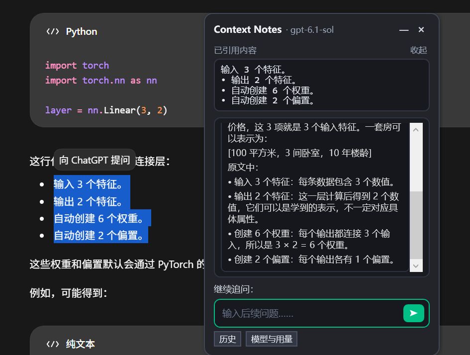
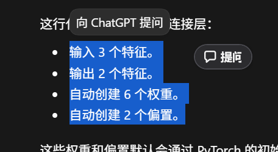

# Context Notes Native

> A native Windows companion for **Codex Desktop Chat** — select assistant responses, attach contextual notes, preserve exact quoted content, ask multi-turn follow-up questions in independent annotation windows, and manage persistent local SQLite conversation history.

[](LICENSE)
[](#系统要求--system-requirements)
[](#系统要求--system-requirements)
[](https://github.com/x549d/context-notes-native/actions/workflows/ci.yml)

> **独立第三方声明 / Independence Notice**：本项目（原开发代号 `ChatGPT Context Notes Native`）是采用 **MIT 许可证**的独立开源 Windows 桌面工具，**与 OpenAI 无关联，未获 OpenAI 官方认证、赞助或背书**。"OpenAI"、"ChatGPT" 与 "Codex" 为 OpenAI 的注册商标。

---

## 快速下载 / Quick Download

普通 Windows 用户**无需阅读源码或自行编译**，直接前往 [GitHub Releases (`v0.3.0`)](https://github.com/x549d/context-notes-native/releases/tag/v0.3.0) 下载：

| 分发形态 | 下载入口 | 适用人群 |
| --- | --- | --- |
| **Windows 标准安装包（推荐）** | [`ContextNotesNative-0.3.0-setup.exe`](https://github.com/x549d/context-notes-native/releases/latest/download/ContextNotesNative-0.3.0-setup.exe) | 绝大多数用户：向导一键安装，无需管理员权限，支持系统“应用和功能”卸载 |
| **Windows 绿色便携包** | [`ContextNotesNative-0.3.0-portable.zip`](https://github.com/x549d/context-notes-native/releases/latest/download/ContextNotesNative-0.3.0-portable.zip) | 偏好免安装解压管理、需要自行指定目录的进阶用户 |
| **SHA-256 校验清单** | [`SHA256SUMS`](https://github.com/x549d/context-notes-native/releases/latest/download/SHA256SUMS) | 所有用户：运行前核验下载文件完整性 |

---

## 实际运行演示 / Screenshots

以下是 **Context Notes Native v0.3.0 的真实 Windows 运行截图**，展示在 Codex Desktop Chat 中选中助手回答、引用原文，以及在旁注窗口中继续向 AI 提问。

### 1. 选区引用、AI 回答与继续追问



*在 Codex Chat 原文旁打开独立的 Context Notes 窗口，保留所选内容并支持持续追问。*

### 2. 划词后出现「提问」按钮



*选中助手回答的文字时，选区旁显示浮动「提问」入口，无需复制粘贴。*

更多完整交互说明参见 [操作演示文档](docs/DEMO.md)。

---

## 项目介绍 / Overview

**Context Notes Native** 专为 Windows 版 **Codex Desktop** 的 **Chat 模式**设计，提供原生、低侵入的“划词旁注追问”体验：

- 在助手回答中划选任意一段文字或代码块；
- 选区旁立即弹出不抢焦点的 **「提问」** 浮动按钮；
- 点击后在选区旁打开独立旁注小框，自动原样引用所选文本并聚焦输入框；
- 直接输入追问并按 `Enter`，通过本机官方 `codex.exe app-server` 实时流式获取 AI 回答，无需复制粘贴、切换窗口或打断主对话流。

---

## 核心功能 / Features

1. **精准原生选区捕获**：基于 Windows UI Automation（UIA）直接读取 Codex Chat 助手回答的选区文本与屏幕坐标，完整保留连续空格、缩进与换行，**不占用系统剪贴板**。
2. **不抢焦点浮动入口**：选区旁浮动显示「提问」按钮（`WS_EX_NOACTIVATE`），不打断阅读、滚动或主窗口焦点。
3. **选区旁独立旁注小框**：点击按钮打开贴近选区的旁注窗口，自动原样引用选中文本、自动聚焦输入框，完整支持中文输入法（IME）、拖动定位、多显示器/混合 DPI 适配、折叠与关闭。
4. **官方 App Server 流式回答**：仅通过本机官方 `codex.exe app-server`（stdio JSON-RPC 2.0）获取真实 AI 回答，实时流式渲染 Markdown 与代码块（支持代码原样复制、折叠与安全 HTTP(S) 链接）。
5. **连续多轮追问与多旁注并发**：每个旁注拥有独立 `ThreadId`，支持同一旁注多轮追问及多个旁注同时独立流式生成，互不串流。
6. **生成取消与异常恢复**：支持点击「停止」实时中断服务端生成（`turn/interrupt`），支持 App Server 异常重启后的自动恢复与上下文重锚定。
7. **本地 SQLite 持久化历史**：按 `Ctrl+Alt+H` 打开历史管理窗口，支持按账号隔离、关键词搜索、日期筛选、重命名、归档、软删除回收站、恢复原 Thread、二次确认永久删除与一致性在线备份。
8. **模型目录与用量查看**：直接读取 App Server 提供的模型目录与限额快照，可设置账号默认模型或单旁注模型。
9. **零管理员权限双分发**：提供标准 EXE 安装器与绿色便携 ZIP，卸载**默认保留**用户本地历史数据库。

---

## 操作演示与截图说明 / Walkthrough & Demo

```text
[Codex Desktop Chat 助手回答]
  │  1. 鼠标划选任意文字/代码块（不占用剪贴板）
  ▼
[选区旁浮动「提问」按钮]  (不抢焦点 WS_EX_NOACTIVATE)
  │  2. 点击「提问」
  ▼
[独立旁注小框 AnnotationWindow]
  ├── 原文引用区（原样保留空格/缩进/换行，可折叠）
  ├── 多轮流式问答区（Markdown / 代码复制 / 独立 ThreadId）
  └── 输入框（自动聚焦 / 中文 IME / Enter 发送 / Shift+Enter 换行 / 停止生成）
  │  3. 自动持久化至本地 SQLite；随时 Ctrl+Alt+H 搜索、恢复或归档
  ▼
[%USERPROFILE%\.context-notes-native\data\history.db]
```

完整的 6 大核心场景交互说明、界面细节与脱敏截屏规范请查看 **[docs/DEMO.md](docs/DEMO.md)**。

> **真实截图**：本页上方已展示选区提问按钮和旁注回答窗口；其他演示场景及未来截图补充规范见 [docs/DEMO.md](docs/DEMO.md)。

---

## 系统要求 / System Requirements

- **操作系统**：Windows 10（2004 / Build 19041 及以上）或 Windows 11（64 位 `x64`）
- **运行库**：[.NET 10 Windows Desktop Runtime x64](https://dotnet.microsoft.com/en-us/download/dotnet/10.0)（框架依赖部署，需先安装）
- **宿主客户端**：已安装并登录的 Windows 版 **Codex Desktop**（提供官方 `codex.exe app-server`）
- **权限要求**：仅需当前普通 Windows 用户权限（**无需管理员权限**，不写 `HKLM`）

---

## 安装步骤 / Installation

### 方式一：Windows 标准安装包（推荐）

1. 前往 [GitHub Releases](https://github.com/x549d/context-notes-native/releases) 下载 `ContextNotesNative-0.3.0-setup.exe` 和 `SHA256SUMS`。
2. 校验文件完整性（PowerShell）：
   ```powershell
   Get-FileHash .\ContextNotesNative-0.3.0-setup.exe -Algorithm SHA256
   ```
   确认输出结果与 `SHA256SUMS` 中对应行一致。
3. 将安装包保存在普通用户目录（如“下载”或“桌面”），双击按向导完成安装：
   - 默认安装目录：`%LOCALAPPDATA%\Programs\ContextNotesNative\versions\0.3.0`
   - 自动注册 Codex 本地插件 marketplace 与 `SessionStart` Hook，并创建当前用户启动监视器快捷方式。
   - **卸载方法**：在 Windows「设置 → 应用 → 已安装的应用」中卸载，**默认保留本地历史数据库**；若确需清空历史可在卸载提示中明确选择删除。

> **关于 Windows SmartScreen / “未知发布者”提示**：`0.3.0` 安装器与可执行文件目前为**未签名发布（`NotSigned`）**，运行 `setup.exe` 时 Windows 可能提示未知发布者。请务必先核对 `SHA256SUMS`，或审阅开源代码后从源码自行编译。代码签名计划见 [docs/SIGNING-PLAN.md](docs/SIGNING-PLAN.md)。

### 方式二：Windows 绿色便携包

1. 下载 `ContextNotesNative-0.3.0-portable.zip` 与 `SHA256SUMS` 并核对哈希。
2. 解压到一个长期保留的普通用户目录。
3. 在解压目录打开 PowerShell 执行安装注册：
   ```powershell
   powershell -NoProfile -ExecutionPolicy Bypass -File .\scripts\Manage-Installation.ps1 -Action Install
   ```
4. 如需取消注册并卸载便携版（默认保留历史）：
   ```powershell
   powershell -NoProfile -ExecutionPolicy Bypass -File .\scripts\Manage-Installation.ps1 -Action Uninstall
   ```

详细安装、升级、回滚与数据备份/恢复步骤见 [docs/INSTALLATION.md](docs/INSTALLATION.md)。

---

## 使用教程 / Usage

1. 启动 Windows 版 **Codex Desktop** 并切换到 **Chat 模式**。
2. 鼠标选中任意一段助手回答，点击选区旁出现的 **「提问」** 浮动按钮。
3. 在弹出的旁注小框中输入追问：
   - `Enter`：发送问题
   - `Shift+Enter`：换行
   - **「停止」**：实时取消正在流式生成的回答
   - **「模型与用量」**：查看可用模型目录与限额，切换默认模型或单旁注模型
4. 按 **`Ctrl+Alt+H`**（或点击旁注窗口的 **「历史」** 按钮）打开本地历史窗口，检索、归档、恢复或管理历史旁注。
5. 常用后台状态与控制命令：
   ```powershell
   SelectionProbe.exe --status
   SelectionProbe.exe --watcher-status
   SelectionProbe.exe --stop-watcher
   SelectionProbe.exe --stop
   ```

完整使用指南见 [docs/USER-GUIDE.md](docs/USER-GUIDE.md)。

---

## 常见问题 / FAQ

- **为什么双击 `setup.exe` 时 Windows 提示“未知发布者”？**
  本版本尚未配置商业可信代码签名证书（`NotSigned`）。运行前请先对照 `SHA256SUMS` 校验下载文件哈希，或直接从源码编译。详见 [docs/SIGNING-PLAN.md](docs/SIGNING-PLAN.md)。
- **为什么在某些沙箱/低完整性目录直接运行安装器会报 Error 5？**
  若安装文件所在目录带有 `Low Mandatory Level` SACL，Windows MIC 会拒绝其写入 `%TEMP%` 与 `HKCU`。请将 `setup.exe` 复制到普通用户目录（如“下载”或“桌面”）后再运行，无需管理员权限。
- **划选文字后没有出现「提问」按钮？**
  请确认当前位于 Codex Desktop 的 **Chat 模式** 且选中的是**助手回答**（用户消息和输入框不会触发）；随后运行 `SelectionProbe.exe --status` 与 `--watcher-status` 检查后台状态，或在 Codex 插件设置中确认 Hook 已启用。
- **卸载软件会删除历史记录吗？**
  不会。标准卸载与便携卸载均**默认保留** `%USERPROFILE%\.context-notes-native\data\history.db` 及备份目录；仅在用户明确选择删除历史时才会清除。
- **如何备份或迁移本地历史数据库？**
  使用内置一致性在线备份命令：
  ```powershell
  SelectionProbe.exe --history-backup "%USERPROFILE%\.context-notes-native\data\history.db" ".\history-backup.db"
  SelectionProbe.exe --history-check ".\history-backup.db"
  ```

更多故障排查步骤见 [docs/TROUBLESHOOTING.md](docs/TROUBLESHOOTING.md)。

---

## 隐私与数据管理 / Privacy & Data Management

### 本地数据存储位置

所有本地数据均保存在当前 Windows 用户目录，不上传至任何第三方自建服务器：

| 类型 | 路径 | 说明 |
| --- | --- | --- |
| 历史数据库 | `%USERPROFILE%\.context-notes-native\data\history.db` | 保存引用原文、提问、回答、草稿、模型选择、账号作用域指纹、ThreadId 与窗口坐标（SQLite WAL 模式，无应用层加密） |
| 自动与手工备份 | `%USERPROFILE%\.context-notes-native\backups\` | 退出自动备份、升级前在线备份与手工导出快照 |
| 诊断日志 | `%USERPROFILE%\.context-notes-native\logs\` | 仅记录运行状态与元数据，不记录完整对话正文或凭据 |

### 隐私与安全边界

- **AI 云端处理说明**：本机 `codex.exe app-server` 是官方桥接进程，**并非完全离线 AI**。发起提问时，所选引用原文、用户提问及恢复对话所需上下文会经官方 Codex 服务发送至 OpenAI 云端处理，受用户自身 OpenAI 账号服务条款与[隐私政策](https://openai.com/policies/privacy-policy/)约束。
- **零凭据窃取、零遥测**：不注入 Codex 进程，不读取浏览器 Cookie、进程内存、密码或 OAuth Token，生产代码不含 `HttpClient`、`WebRequest`、`Socket` 或任何遥测代码。
- **零生产第三方 NuGet 依赖**：主程序 `SelectionProbe` 仅调用 .NET 10 / WPF 与 Windows 系统库（含系统自带 `winsqlite3.dll`）。
- 完整政策见 [PRIVACY.md](PRIVACY.md)、[SECURITY.md](SECURITY.md) 与 [docs/SECURITY.md](docs/SECURITY.md)。

---

## 项目架构 / Architecture

```text
+--------------------------+        UIA / Win32 (Read-only)       +-----------------------------+
|   Codex Desktop (Chat)   | <----------------------------------- |   SelectionProbe Companion  |
|   Windows Desktop App    | --- SessionStart Hook (Plugin) ----> |   (.NET 10 / WPF / x64)     |
+--------------------------+                                      +--------------+--------------+
                                                                                 |
                                                     +---------------------------+---------------------------+
                                                     | stdio JSON-RPC 2.0                                    | P/Invoke (winsqlite3.dll)
                                                     v                                                       v
                                      +------------------------------+                        +------------------------------+
                                      | Official codex.exe app-server|                        | Local SQLite (WAL Mode)      |
                                      | (Thread / Stream / Interrupt)|                        | %USERPROFILE%\.context-notes |
                                      +------------------------------+                        +------------------------------+
```

### 仓库目录结构

```text
.github/                         GitHub Actions CI/Release 工作流与 Issue/PR 模板
ChatGptContextNotesNative.sln    .NET 10 解决方案（主程序 + xUnit 测试）
src/SelectionProbe/              WPF / UIA / Win32 / SQLite / App Server 主程序
tests/SelectionProbe.Tests/      xUnit 单元测试工程（106 项）
tests/HistoryDeletion.Acceptance/ 独立合成库永久删除验收工具（23 项）
codex-plugin/                    Codex 本地插件清单与 SessionStart Hook
installer/ContextNotes.iss       Inno Setup 当前用户安装脚本
scripts/                         构建、安装、卸载、诊断与自动化验证脚本
docs/                            架构文档、演示说明、用户指南、安全/许可与验收报告
```

更多架构细节见 [docs/APP-SERVER-ARCHITECTURE.md](docs/APP-SERVER-ARCHITECTURE.md) 与 [docs/PROJECT-SPEC.md](docs/PROJECT-SPEC.md)。

---

## 开发环境与从源码构建 / Development & Building from Source

### 开发前置要求

- Windows 10 (2004+) 或 Windows 11 (`x64`)
- [.NET 10 SDK](https://dotnet.microsoft.com/en-us/download/dotnet/10.0)
- [Inno Setup 6](https://jrsoftware.org/isinfo.php)（仅构建 `setup.exe` 安装包时需要）

### 本地构建与测试命令

```powershell
# 1. Release 构建（0 警告、0 错误）
dotnet build ChatGptContextNotesNative.sln -c Release

# 2. 运行全部 106 项 xUnit 单元测试
dotnet test ChatGptContextNotesNative.sln -c Release --no-build

# 3. 运行内置 80 项自测
dotnet src/SelectionProbe/bin/Release/net10.0-windows/SelectionProbe.dll --self-test

# 4. 本地注册插件并热重启后台（可选）
powershell -NoProfile -ExecutionPolicy Bypass -File .\scripts\Install-Plugin.ps1 -SkipMarketplace
```

### 测试与审计现状

- **已验证通过**：Release 0 警告/0 错误、106 项 xUnit 单元测试、80 项内置自测、13 项发布包审计、29 项标准 EXE 隔离安装/升级/回滚/卸载验证、19 项便携安装管理验证、23 项独立合成库永久删除验证、三浮窗真实并发与重启恢复、30 分钟连续稳定性采样（61 样本、0 重启、0 错误日志），以及完整 Git 历史隐私清理与 Gitleaks 0 泄露复扫。
- **已知未覆盖项**：独立干净 Windows OS（全新虚拟机/云主机）全流程安装验收当前标记为 **`NOT TESTED`**；可信 Authenticode 代码签名当前为 **`NotSigned`**。

---

## 参与贡献 / Contributing

欢迎提交 Bug 报告、兼容性反馈、功能建议与 Pull Request！

- 贡献指南与安全红线：[CONTRIBUTING.md](CONTRIBUTING.md)
- 提交问题与反馈：[GitHub Issues](https://github.com/x549d/context-notes-native/issues)
- 变更日志：[CHANGELOG.md](CHANGELOG.md)
- 第三方组件与商标声明：[docs/THIRD-PARTY-NOTICES.md](docs/THIRD-PARTY-NOTICES.md)

---

## 许可证 / License

本项目自有代码采用 **[MIT License](LICENSE)**（Copyright (c) 2026 x549d）。
